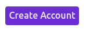

[](https://github.com/praveenganeshcp/simple-widgets/actions/workflows/publish.yml)

# Simple Widgets  


Simple Widgets is a UI component library built using [**Angular**](https://angular.io) and it is available as a [**NPM package**](https://www.npmjs.com/package/ngx-simple-widgets) to download. Currently the library has a palette of 6 components and few more will be added in the future. All the components encapsulates the core logic and provides a simple API for the consumer to work with it.

> ##### NOTE : This library is built for learning purpose and not recommended to use in production.

## Storybook
This library has a hosted [**Storybook docs**](https://main--63a11b6320c4ef99cb67aa93.chromatic.com/?path=/story/introduction--page), which serves as a playground to interact with components and as a documentation to learn about their usage.

## Installation
```sh
npm install ngx-simple-widgets 
```

## Usage

#### Import the module  

To use a particular component or a service, the respective module needs to be imported into the working module.

```js
import { SwButtonModule } from "ngx-simple-widgets"; 
imports: [
  SwButtonModule
]
```

#### Use the component

```html
<button sw-primary-button>Click me!</button>
```

#### Output

